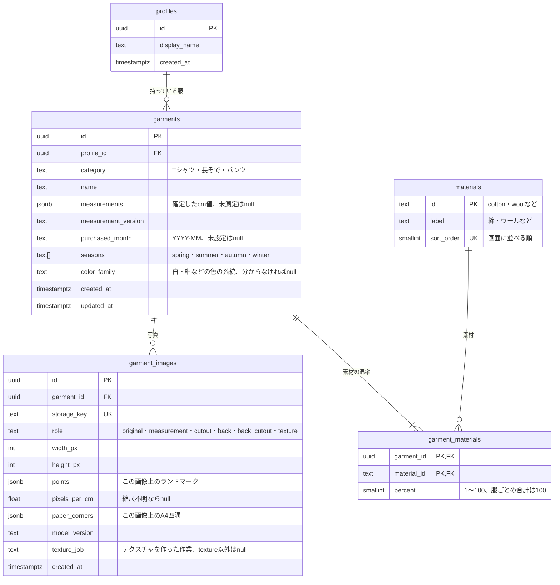

# ER図

初期テーブルは`supabase/migrations/20261010000100_garment_measurements.sql`、透過画像の追加は`20261010000200_garment_cutouts.sql`、裏面の写真と購入時期・季節の追加は`20261013000100_garment_back_and_details.sql`、テクスチャの追加は`20261017000300_garment_texture.sql`と`20261017000500_save_texture_checks_back.sql`、素材の追加は`20261018000100_garment_materials.sql`。アバターとコーデのテーブルはまだ作っていない。

- profilesのデモ用1行を`supabase/seed.sql`で用意する。apiはDEMO_PROFILE_IDだけを使用する。
- categoryはshort_sleeve_top・long_sleeve_top・shirt・trousers。長そでは20261017000100_long_sleeve_top.sql、シャツは20261017000400_shirt_category.sqlで既存のカテゴリ制約を拡張する。measurementsは[API一覧](api.md)の共通型。
- 画像は服1着につき各roleを1枚ずつ保存できる。現在のv2ではランドマーク・A4四隅ともmeasurement画像に保存する。cutoutは表示用PNGでpoints・paper_cornersは空配列、pixels_per_cmはnull。旧v1ではA4四隅はoriginal画像にある。
- backは裏面のJPEG、back_cutoutは裏面の表示用PNG。どちらも採寸しないため、points・paper_cornersは空配列、pixels_per_cm・model_versionはnull。差し替えのたびに新しいキーで保存し、行の入れ替えは関数`replace_garment_back`（`20261017000200_replace_garment_back.sql`）で1つのトランザクションにする。関数はapiの`service_role`だけが実行できる（[ADR 0020](adr/0020-back-photo-as-separate-role.md)）。
- textureは推論サービスが作ったテクスチャのPNG。apiが推論サービスから受け取って保存し、作業フォルダ名を`texture_job`に持つ。差し替えは関数`save_garment_texture`で1つのトランザクションにし、同じ作業は2回保存しない。関数は服の行をロックしたまま、作業のもとになった裏面が今の裏面かを確かめ直し、違えば保存しない（`20261017000500_save_texture_checks_back.sql`）（[ADR 0033](adr/0033-serve-texture-through-api.md)）。
- 購入時期と季節は[ADR 0021](adr/0021-purchase-month-and-seasons.md)を参照。
- 素材は混率で持ち、服1着につき1行以上（綿98%・ポリウレタン2%なら2行）。合計100%は、差し替えの関数`set_garment_materials`が確かめる。素材を入れずに登録した服と、素材を足す前の服は綿100%にする。素材の一覧`materials`はmigrationで入れ、画面からは足さない。
- 色の系統は、webが切り抜きの色から決める。前からある服と、色を決められなかった服はnull（[ADR 0042](adr/0042-color-family-from-cutout.md)）。
- 元画像とはブラウザで向き・縮小・EXIF除去を確定した画像であり、カメラの元ファイルとは異なる。
- 全テーブルでRLSを有効にし、公開ポリシーは設けない。apiのsecret keyだけがDBを操作する。
- Storageは非公開のgarmentsバケット。JPEG・PNGを許可し、1枚16MiBまで（テクスチャのために上げた。実際のテクスチャは約0.5MB。利用者が上げる写真は、apiが8MiBまでに抑える）。apiが期限付きURLを発行する。
- Storageの画像はDBの外部キー削除では消えないため、削除サービスが両方を処理する。

## 今後の設計候補

アバターはprofilesと1対1、コーデはprofilesと1対多、コーデと服は中間テーブルで多対多を想定する。体型・テクスチャの要件は[要件候補](requirements-candidates.md)を参照。

アバターを保存する場合の候補は`height_cm`（150〜195）と`build`（`slim`・`standard`・`broad`・`chubby`）。体重は持たない（[ADR 0008](adr/0008-height-keys-and-tables.md)、[ADR 0009](adr/0009-build-instead-of-weight.md)）。これらの列・テーブルは未作成で、上のER図には含めない。
