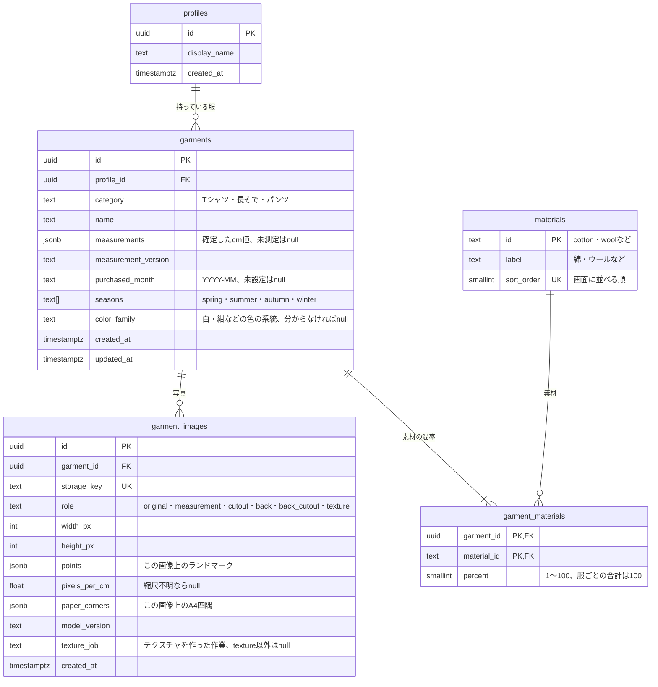

# ER図

テーブルを作ったmigrationは次のとおり。アバターとコーデのテーブルは、まだ作っていない。

- 最初のテーブル：`supabase/migrations/20261010000100_garment_measurements.sql`
- 透過画像：`20261010000200_garment_cutouts.sql`
- 裏面の写真と、購入時期・季節：`20261013000100_garment_back_and_details.sql`
- テクスチャ：`20261017000300_garment_texture.sql`と`20261017000500_save_texture_checks_back.sql`
- 素材：`20261018000100_garment_materials.sql`

- profilesのデモ用の1行は、`supabase/seed.sql`で入れる。apiはDEMO_PROFILE_IDだけを使う。
- categoryはshort_sleeve_top・long_sleeve_top・shirt・trousers。長そでは20261017000100_long_sleeve_top.sql、シャツは20261017000400_shirt_category.sqlで、今あるカテゴリの制約を広げる。measurementsは、[API一覧](api.md)の共通の型。
- 画像は、服1着につき、roleごとに1枚ずつ保存できる。今のv2では、ランドマークもA4の四隅も、measurement画像に保存する。cutoutは表示用のPNGで、points・paper_cornersは空の配列、pixels_per_cmはnull。前のv1では、A4の四隅はoriginal画像にある。
- backは裏面のJPEG、back_cutoutは裏面の表示用PNG。どちらも採寸しないので、points・paper_cornersは空の配列、pixels_per_cm・model_versionはnull。差し替えのたびに新しいキーで保存し、行の入れ替えは関数`replace_garment_back`（`20261017000200_replace_garment_back.sql`）で1つのトランザクションにする。関数はapiの`service_role`だけが実行できる（[ADR 0020](adr/0020-back-photo-as-separate-role.md)）。
- textureは推論サービスが作ったテクスチャのPNG。apiが推論サービスから受け取って保存し、作業フォルダ名を`texture_job`に持つ。差し替えは関数`save_garment_texture`で1つのトランザクションにし、同じ作業は2回保存しない。関数は服の行をロックしたまま、作業のもとになった裏面が今の裏面かを確かめ直し、違えば保存しない（`20261017000500_save_texture_checks_back.sql`）（[ADR 0033](adr/0033-serve-texture-through-api.md)）。
- 購入時期と季節は[ADR 0021](adr/0021-purchase-month-and-seasons.md)を参照。
- 素材は混率で持ち、服1着につき1行以上（綿98%・ポリウレタン2%なら2行）。合計100%は、差し替えの関数`set_garment_materials`が確かめる。素材を入れずに登録した服と、素材を足す前の服は綿100%にする。素材の一覧`materials`はmigrationで入れ、画面からは足さない。
- 色の系統は、webが切り抜きの色から決める。前からある服と、色を決められなかった服はnull（[ADR 0044](adr/0044-color-family-from-cutout.md)）。
- 元画像は、ブラウザで向き・縮小・EXIFの除去を済ませた画像で、カメラの元のファイルとは違う。
- すべてのテーブルでRLSを有効にし、公開のポリシーは作らない。DBを操作するのは、apiのsecret keyだけ。
- Storageは非公開のgarmentsバケット。JPEG・PNGを許可し、1枚16MiBまで（テクスチャのために上げた。実際のテクスチャは約0.5MB。利用者が上げる写真は、apiが8MiBまでに抑える）。期限付きのURLは、apiが出す。
- Storageの画像は、DBの外部キーで行を消しても消えない。削除サービスでDBの行とStorageの画像を両方消す。

## 今後の設計候補

アバターはprofilesと1対1、コーデはprofilesと1対多、コーデと服は中間テーブルで多対多を考えている。体型とテクスチャの要件は、[要件候補](requirements-candidates.md)を見る。

アバターを保存するときの列の候補は`height_cm`（150〜195）と`build`（`slim`・`standard`・`broad`・`chubby`）。体重は持たない（[ADR 0008](adr/0008-height-keys-and-tables.md)、[ADR 0009](adr/0009-build-instead-of-weight.md)）。これらの列とテーブルはまだ作っておらず、上のER図には入れていない。
